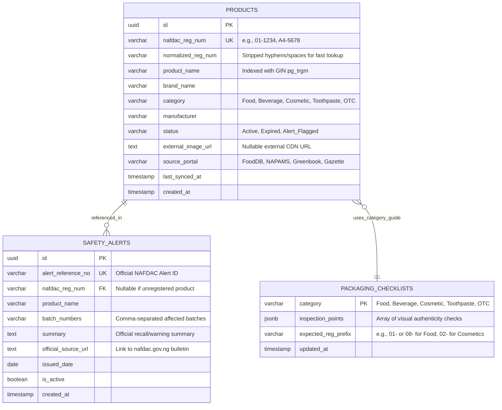

# Development Execution Plan: CheckAm

**Project:** CheckAm (Offline-First Consumer Product Verification PWA)  
**Target Release:** V1 MVP  
**Last Updated:** November 20, 2026

---

## 1. Technical Stack

* **Frontend (Mobile PWA):** React 18 (Vite) + TypeScript + Tailwind CSS, `vite-plugin-pwa` (Workbox Service Workers for offline asset caching), `Dexie.js` (IndexedDB wrapper for offline product catalog storage), `Tesseract.js` (client-side OCR on HTML5 Canvas downscaled frames), and `zxing-wasm` (1D/2D barcode scanning).
* **Backend API:** Python 3.12 + FastAPI with async `httpx` and Pydantic v2 validation for lightweight, high-concurrency REST endpoints.
* **Database & Search Engine:** PostgreSQL 16 with `pg_trgm` (Trigram similarity extension) and `GIN` indexes for sub-100ms fuzzy product name and NAFDAC registration number lookups.
* **Caching Layer:** Redis (Upstash or self-hosted container) for caching frequent search queries and serving pre-compressed offline JSON sync bundles.
* **ETL & Orchestration:** Python (`Playwright` for dynamic portals like NAPAMS/Food DB, `httpx` for NAFDAC Greenbook AJAX JSON endpoints, `pdfplumber` for NAFDAC Public Safety Alert & Gazette PDFs) automated via GitHub Actions weekly scheduled Cron workflows.
* **Deployment & Hosting:** Vercel or Cloudflare Pages (Frontend PWA Edge CDN) + Railway / Render / Fly.io (FastAPI + PostgreSQL + Redis).

---

## 2. Database Schema Design

### 2.1 Entity-Relationship Diagram (ERD)

### 2.2 Table & Index Definitions

1. **`products` Table**
   * `id` (`UUID`, Primary Key, default `gen_random_uuid()`)
   * `nafdac_reg_num` (`VARCHAR(50)`, Unique, Not Null) — Official formatted registration number (e.g., `01-4582`).
   * `normalized_reg_num` (`VARCHAR(50)`, Not Null) — Uppercase alphanumeric string with hyphens/spaces removed (`014582`) for instant scanner/user matching.
   * `product_name` (`VARCHAR(255)`, Not Null) — Full registered product name and pack size.
   * `brand_name` (`VARCHAR(150)`, Nullable) — Commercial brand name.
   * `category` (`VARCHAR(50)`, Not Null) — Enum-like string (`Food`, `Beverage`, `Toothpaste`, `Cosmetic`, `OTC`).
   * `manufacturer` (`VARCHAR(255)`, Not Null) — Registered local manufacturer or importer.
   * `status` (`VARCHAR(30)`, Not Null, default `'Active'`) — Objective registry state (`Active`, `Expired`, `Alert_Flagged`).
   * `external_image_url` (`TEXT`, Nullable) — External manufacturer/CDN image URL (zero binary storage).
   * `source_portal` (`VARCHAR(50)`, Not Null) — Origin tracker (`FoodDB`, `NAPAMS`, `Greenbook`, `Gazette`).
   * `last_synced_at` (`TIMESTAMPTZ`, Not Null, default `NOW()`)
   * **Indexes:**
     * `idx_products_norm_reg` (`B-Tree` on `normalized_reg_num`) for `O(log n)` exact registration lookups.
     * `idx_products_name_trgm` (`GIN` on `product_name gin_trgm_ops`) for sub-50ms fuzzy typo-tolerant search.
     * `idx_products_category` (`B-Tree` on `category`) for fast home feed filtering.

2. **`safety_alerts` Table**
   * `id` (`UUID`, Primary Key)
   * `alert_reference_no` (`VARCHAR(100)`, Unique, Not Null) — Official NAFDAC alert identifier (e.g., `Alert No. 042/2026`).
   * `nafdac_reg_num` (`VARCHAR(50)`, Nullable, Foreign Key -> `products.nafdac_reg_num` `ON DELETE SET NULL`) — Linked if the alert concerns a registered product with falsified batches.
   * `product_name` (`VARCHAR(255)`, Not Null) — Name of recalled/flagged product.
   * `batch_numbers` (`VARCHAR(255)`, Nullable) — Specific flagged batch codes.
   * `summary` (`TEXT`, Not Null) — Concise factual summary of the NAFDAC notice.
   * `official_source_url` (`TEXT`, Not Null) — Direct URL to the official `nafdac.gov.ng` public alert post.
   * `issued_date` (`DATE`, Not Null)
   * `is_active` (`BOOLEAN`, default `TRUE`)

3. **`packaging_checklists` Table**
   * `category` (`VARCHAR(50)`, Primary Key)
   * `inspection_points` (`JSONB`, Not Null) — Structured list of physical checks (e.g., `[{"label": "Date Delimiter", "detail": "Verify hyphens vs slashes on batch print"}]`).
   * `expected_reg_prefix` (`VARCHAR(50)`, Not Null) — Standard NAFDAC prefix rule for the category.

### 2.3 Migration & Sync Notes
* **Idempotent Upserts:** All ETL workers must execute `INSERT INTO products (...) ON CONFLICT (nafdac_reg_num) DO UPDATE SET status = EXCLUDED.status, last_synced_at = NOW()` so recurring weekly syncs update statuses without breaking client IndexedDB references.
* **Offline Delta Bundle Generation:** At the end of each successful ETL run, a post-processing script exports a minified JSON payload (`offline_catalog.json.gz`, target `< 2.5MB`) containing core fields (`nafdac_reg_num`, `normalized_reg_num`, `product_name`, `category`, `manufacturer`, `status`) to Redis/CDN for PWA background syncing.

---

## 3. Execution Roadmap

| ID | Task | PRD Ref | Status |
| :--- | :--- | :--- | :--- |
| **1.1** | Provision PostgreSQL 16 with `pg_trgm` extension and apply Alembic migrations for `products`, `safety_alerts`, and `packaging_checklists`. | `[FR002]`, `[FR007]` | 📅 Next |
| **1.2** | Build Python/Playwright ETL scraper for NAFDAC Food Products Database (`nafdac.gov.ng/food-products-database/`) & NAPAMS portal. | `[FR007]` | 📅 Next |
| **1.3** | Build Python `pdfplumber` parser for NAFDAC Public Safety Alerts & Gazette PDFs to populate `safety_alerts`. | `[FR001]`, `[FR007]` | 📅 Next |
| **1.4** | Build Python `httpx` JSON client for NAFDAC Greenbook jQuery DataTables endpoint (filtered for common OTC consumables). | `[FR007]` | 🧊 Backlog |
| **1.5** | Configure GitHub Actions weekly Cron workflow with retry logic, category filtering, and Discord/Telegram failure alerts. | `[FR007]` | 🧊 Backlog |
| **2.1** | Build FastAPI REST endpoints (`GET /api/v1/products`, `GET /api/v1/search`, `GET /api/v1/alerts`, `GET /api/v1/sync-bundle`). | `[FR001]`, `[FR002]` | 🧊 Backlog |
| **2.2** | Integrate Redis caching layer for frequent trigram queries and pre-compressed offline sync bundles. | `[NFR003]` | 🧊 Backlog |
| **3.1** | Initialize mobile-first React + TypeScript PWA shell with Workbox Service Worker, HTTP cache headers, and Web App Manifest. | `[NFR001]`, `[NFR004]` | 🧊 Backlog |
| **3.2** | Implement Dexie.js (IndexedDB) local database and background sync worker for 100% offline market searches. | `[FR002]`, `[NFR004]` | 🧊 Backlog |
| **3.3** | Build Home Feed UI featuring the NAFDAC Safety Alert Carousel, category filter pills, and virtualized product cards. | `[FR001]` | 🧊 Backlog |
| **3.4** | Build Camera Scanner modal with HTML5 Canvas downscaling (`max-width: 720px`) + `Tesseract.js` OCR and `zxing-wasm` barcode reader. | `[FR003]` | 🧊 Backlog |
| **3.5** | Build Product Detail view with external image `onError` SVG fallbacks, interactive Packaging Checklist, legal disclaimer, and Web Share API. | `[FR004]`, `[FR005]`, `[FR006]` | 🧊 Backlog |
| **4.1** | Conduct Lighthouse mobile audit (3G throttling, 2GB RAM profile) and optimize initial JS bundle under `150KB` gzipped. | `[NFR002]`, `[NFR005]` | 🧊 Backlog |

---

## 4. Immediate Technical Next Steps

1. **Initialize Monorepo & Tooling:** Set up `/etl`, `/backend`, and `/frontend` directories with strict static analysis (`ruff` + `mypy` for Python, `eslint` + `tsc --noEmit` for TypeScript).
2. **Inspect Live NAFDAC DOM & XHR Structures:** Open Chrome DevTools on `nafdac.gov.ng/food-products-database/` and `registration.nafdac.gov.ng` to document exact table pagination selectors and request headers.
3. **Execute Database Migration (`1.1`):** Enable `CREATE EXTENSION IF NOT EXISTS pg_trgm;` in PostgreSQL and run the initial schema migration script along with seed data for `packaging_checklists`.
4. **Run Seed ETL Ingestion (`1.2` & `1.3`):** Execute the initial scraper locally to ingest at least 500 verified food, beverage, and toothpaste records plus active 2026 NAFDAC public alerts.

---

## 5. Quality Gates & Definition of Done

* **Build Integrity:** Zero TypeScript compilation errors (`tsc --noEmit`), zero ESLint warnings, and zero Python `ruff`/`mypy` errors before any task is marked `✅ Done`.
* **Verification & Latency:** Automated Pytest integration tests must confirm `/api/v1/search` returns valid Pydantic schemas in `< 300ms` (p95), and ETL upsert tests must verify idempotency across repeated runs without duplicate records.
* **Environment Safety:** All database URIs, Redis credentials, and webhook alert URLs must be injected via `.env` environment variables (`.env` gitignored); zero secrets committed to source control.
* **Domain & Hardware Verification:**
  * **Offline Market Simulation:** Toggling Chrome DevTools to `Offline` mode after initial PWA load must allow instant fuzzy search and checklist inspection across synced IndexedDB records with zero unhandled promise rejections.
  * **Low-RAM OCR Memory Check:** Capturing a 12MP smartphone camera frame must downscale via Canvas to `<= 720px` width prior to OCR execution, keeping total browser heap memory under `150MB`.
  * **Legal & Defamation Copy Audit:** Every UI status badge and share template must be audited to confirm objective regulatory phrasing (`Official NAFDAC Match` / `Official Safety Alert`) with zero defamatory claims.