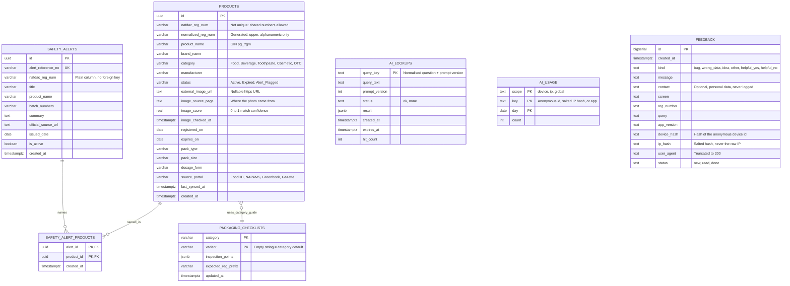

# Development Execution Plan: CheckAm

**Project:** CheckAm (Offline-First Consumer Product Verification PWA)  
**Target Release:** V1 MVP  
**Last Updated:** November 28, 2026

---

## 1. Technical Stack

* **Frontend (Mobile PWA):** React 18 (Vite) + TypeScript + Tailwind CSS, `vite-plugin-pwa` (Workbox Service Workers for offline asset caching), `Dexie.js` (IndexedDB wrapper for offline product catalog storage), `Tesseract.js` (client-side OCR on HTML5 Canvas downscaled frames), and `zxing-wasm` (1D/2D barcode scanning).
* **Backend API:** Python 3.12 + FastAPI with async `httpx` and Pydantic v2 validation for lightweight, high-concurrency REST endpoints.
* **Database & Search Engine:** PostgreSQL 16 with `pg_trgm` (Trigram similarity extension) and `GIN` indexes for sub-100ms fuzzy product name and NAFDAC registration number lookups.
* **Caching Layer:** None server-side yet (Redis was planned, see roadmap `2.2`). The PWA answers most reads from IndexedDB, and AI answers are cached in Postgres (`ai_lookups`).
* **ETL & Orchestration:** Python (`Playwright` for dynamic portals like NAPAMS/Food DB, `httpx` for NAFDAC Greenbook AJAX JSON endpoints, `pdfplumber` for NAFDAC Public Safety Alert & Gazette PDFs) automated via GitHub Actions weekly scheduled Cron workflows.
* **Deployment & Hosting:** Cloudflare Pages (PWA, `checkam.com.ng`) + FastAPI Cloud (API) + Neon (PostgreSQL). GitHub Actions: `deploy-api.yml`, `ci.yml`, `etl.yml`.

---

## 2. Database Schema Design

Source of truth: the Alembic migrations in `db/alembic/versions/` (`0001` to `0008`). Production is PostgreSQL on Neon at revision `0008`. The PWA also keeps an on-device copy (section 2.4).

### 2.1 Entity-Relationship Diagram (ERD)

`ai_lookups`, `ai_usage` and `feedback` have no relations: they are standalone tables.

### 2.2 Table & Index Definitions

1. **`products`** (migrations `0001`, `0003`, `0004`, `0006`)
   * `id` (`UUID`, PK, default `gen_random_uuid()`).
   * `nafdac_reg_num` (`VARCHAR(50)`, Not Null). **Not unique since `0003`**: several products can legitimately share one registration number (for example size variants).
   * `normalized_reg_num` (`VARCHAR(50)`, generated and stored): `upper(regexp_replace(nafdac_reg_num, '[^A-Za-z0-9]', '', 'g'))`, for instant scanner and typed-number matching.
   * `product_name` (`VARCHAR(255)`), `brand_name` (`VARCHAR(150)`, nullable), `manufacturer` (`VARCHAR(255)`).
   * `category` (`VARCHAR(50)`, CHECK in `Food`, `Beverage`, `Toothpaste`, `Cosmetic`, `OTC`).
   * `status` (`VARCHAR(30)`, default `Active`, CHECK in `Active`, `Expired`, `Alert_Flagged`). The API maps these to `match`, `lapsed`, `alert`.
   * `external_image_url` (`TEXT`, nullable, CHECK `https://` only), plus image provenance from `0006`: `image_source_page` (`TEXT`, CHECK `http(s)://`), `image_score` (`REAL`, CHECK 0 to 1), `image_checked_at` (`TIMESTAMPTZ`).
   * Dates and pack data from `0004`: `registered_on`, `expires_on` (`DATE`), `pack_type` (`VARCHAR(40)`), `pack_size` (`VARCHAR(120)`), `dosage_form` (`VARCHAR(60)`).
   * `source_portal` (`VARCHAR(50)`, CHECK in `FoodDB`, `NAPAMS`, `Greenbook`, `Gazette`), `last_synced_at`, `created_at` (`TIMESTAMPTZ`, default `now()`).
   * **Indexes:** `idx_products_norm_reg` (B-Tree on `normalized_reg_num`), `idx_products_reg` (B-Tree on `nafdac_reg_num`), `uq_products_reg_name` (UNIQUE on `nafdac_reg_num, lower(btrim(product_name))`: the idempotent-upsert key), `idx_products_name_trgm` (GIN `gin_trgm_ops` on `product_name`), `idx_products_category`, `idx_products_expires_on`, `idx_products_pack_type`, and the partial `ix_products_image_pending` on `(category, image_checked_at) WHERE external_image_url IS NULL` (finds products still needing an image search).

2. **`safety_alerts`** (`0001`, `0003`, `0004`)
   * `id` (`UUID`, PK), `alert_reference_no` (`VARCHAR(100)`, Unique), `title` (`VARCHAR(500)`, nullable, added in `0004`), `product_name`, `batch_numbers`, `summary`, `official_source_url`, `issued_date`, `is_active`, `created_at`.
   * `nafdac_reg_num` is a plain nullable column. The foreign key to `products` was **dropped in `0003`** because the registration number is no longer unique.
   * **Indexes:** `idx_alerts_active_date` on `(is_active, issued_date DESC)`, `idx_alerts_reg` on `nafdac_reg_num`.

3. **`safety_alert_products`** (`0004`): many-to-many link between alerts and products. PK `(alert_id, product_id)`, both foreign keys `ON DELETE CASCADE`, index `idx_sap_product_id`.

4. **`packaging_checklists`** (`0001`, `0005`): PK is now `(category, variant)`. `variant` is `''` for the category default. `inspection_points` (`JSONB`), `expected_reg_prefix`, `updated_at`. Seeded by `0002` and `0005`.

5. **`ai_lookups`** (`0007`): one row per distinct AI question so the paid provider is never asked twice. PK `query_key` (normalised question plus prompt version), `status` CHECK `ok` or `none`, `result` (`JSONB`), `expires_at` (index `ix_ai_lookups_expires`), `hit_count`.

6. **`ai_usage`** (`0007`): daily counters. PK `(scope, key, day)`, `scope` CHECK `device`, `ip` or `global`, `count >= 0`, index `ix_ai_usage_day`. Limits: 5 per device, 60 per IP and 100 for the whole app per Lagos day.

7. **`feedback`** (`0008`): bug reports, wrong-data reports, ideas and helpful yes or no votes. No accounts: a person is only a hashed anonymous device id and a salted IP hash. `kind` and `status` are CHECK-constrained, `message` and `contact` are optional text, `contact` is never logged. Indexes: `ix_feedback_created_at`, `ix_feedback_device_created`, `ix_feedback_ip_created` (for rate limits).

### 2.3 Migration & Sync Notes
* **Migration history:** `0001` core tables and `pg_trgm`; `0002` packaging checklist seed; `0003` shared registration numbers (drop unique and the alerts foreign key); `0004` registration dates, pack metadata, alert title and the alert-product link table; `0005` checklist variants; `0006` image provenance; `0007` AI lookup cache and usage counters; `0008` feedback.
* **Idempotent upserts:** ETL workers upsert on `(nafdac_reg_num, lower(btrim(product_name)))` (`uq_products_reg_name`), so repeated syncs update status and `last_synced_at` without duplicating rows or breaking client IndexedDB references.
* **Offline bundle:** the API serves a versioned sync bundle (`/api/v1/sync-bundle`, with a manifest endpoint) that the PWA stores in IndexedDB for fully offline search.
* **Running migrations:** `cd db && alembic upgrade head`. Locally the target is the local Postgres; for Neon use the direct (non-pooled) connection string. The API uses the pooled string.

### 2.4 On-device database (Dexie / IndexedDB)
Database `checkam_db`, schema version 3. Nothing here is sent to the server.

| Store | Key and indexes | Holds |
| :--- | :--- | :--- |
| `products` | `id`; `nafdac_reg_num`, `normalized_reg_num`, `product_name`, `brand_name`, `category`, `status`, `manufacturer` | The offline catalog copy |
| `alerts` | `id`; `alert_reference_no`, `nafdac_reg_num`, `is_active`, `issued_date` | Public alerts |
| `checklists` | `[category+variant]` | Packaging checklists |
| `checklist_progress` | `[productId+pointKey]` | The person's tick or cross per check |
| `saved` | `++id`; `productId`, `status`, `savedAt` | Saved product checks |
| `settings` | `key` | Preferences and the 25-entry AI answer cache (`ai:` keys) |
| `ai_saved` (v3) | `++id`; `key`, `savedAt` | AI summaries the person chose to keep, never expired automatically |

---

## 3. Execution Roadmap

Status key: ✅ Done · 🟡 Partly done · 📅 Next · 🧊 Backlog or not started.

| ID | Task | PRD Ref | Status |
| :--- | :--- | :--- | :--- |
| **1.1** | Provision PostgreSQL 16 with `pg_trgm` extension and apply Alembic migrations for `products`, `safety_alerts`, and `packaging_checklists`. | `[FR002]`, `[FR007]` | ✅ Done: local and Neon, revisions `0001` to `0008` |
| **1.2** | Build Python/Playwright ETL scraper for NAFDAC Food Products Database (`nafdac.gov.ng/food-products-database/`) & NAPAMS portal. | `[FR007]` | ✅ Done: `food_db` and `napams` sources, polite pacing and raw-page cache |
| **1.3** | Build Python `pdfplumber` parser for NAFDAC Public Safety Alerts & Gazette PDFs to populate `safety_alerts`. | `[FR001]`, `[FR007]` | ✅ Done: `alerts_pdf` source |
| **1.4** | Build Python `httpx` JSON client for NAFDAC Greenbook jQuery DataTables endpoint (filtered for common OTC consumables). | `[FR007]` | ✅ Done: `greenbook` source |
| **1.5** | Configure GitHub Actions weekly Cron workflow with retry logic, category filtering, and Discord/Telegram failure alerts. | `[FR007]` | 🟡 Built (`etl.yml`: daily alerts, weekly registry, manual run, webhook on failure). First live run timed out reaching nafdac.gov.ng, so not yet proven |
| **2.1** | Build FastAPI REST endpoints (`GET /api/v1/products`, `GET /api/v1/search`, `GET /api/v1/alerts`, `GET /api/v1/sync-bundle`). | `[FR001]`, `[FR002]` | ✅ Done, plus lookup, checklists, meta, AI lookup and feedback |
| **2.2** | Integrate Redis caching layer for frequent trigram queries and pre-compressed offline sync bundles. | `[NFR003]` | 🧊 Not done and not needed yet: the PWA answers most reads from IndexedDB, and Redis is not used |
| **3.1** | Initialize mobile-first React + TypeScript PWA shell with Workbox Service Worker, HTTP cache headers, and Web App Manifest. | `[NFR001]`, `[NFR004]` | ✅ Done |
| **3.2** | Implement Dexie.js (IndexedDB) local database and background sync worker for 100% offline market searches. | `[FR002]`, `[NFR004]` | ✅ Done |
| **3.3** | Build Home Feed UI featuring the NAFDAC Safety Alert Carousel, category filter pills, and virtualized product cards. | `[FR001]` | ✅ Done: alert carousel, category tabs, and an infinite-scroll All products list (rows with thumbnails) instead of virtualization |
| **3.4** | Build Camera Scanner modal with HTML5 Canvas downscaling (`max-width: 720px`) + `Tesseract.js` OCR and `zxing-wasm` barcode reader. | `[FR003]` | 🟡 Tesseract photo scanner done (take photo, drag a box, read, confirm, "Did you mean" suggestions). `zxing-wasm` barcode reading not built |
| **3.5** | Build Product Detail view with external image `onError` SVG fallbacks, interactive Packaging Checklist, legal disclaimer, and Web Share API. | `[FR004]`, `[FR005]`, `[FR006]` | ✅ Done: "No image yet" fallback, tick or cross checklist, share on WhatsApp |
| **4.1** | Conduct Lighthouse mobile audit (3G throttling, 2GB RAM profile) and optimize initial JS bundle under `150KB` gzipped. | `[NFR002]`, `[NFR005]` | 🧊 Not started |

### Work added beyond the original plan

| ID | Task | Status |
| :--- | :--- | :--- |
| **5.1** | Deployment: API on FastAPI Cloud, database on Neon, PWA on Cloudflare Pages, official domain `checkam.com.ng`, GitHub Actions deploy for the API. | ✅ Done (CORS entry for the new domain must be set on FastAPI Cloud) |
| **5.2** | Product image enrichment: parallel pipeline with match scoring and image provenance columns; photos stored and migrated to Neon. | ✅ Done (source and licensing review still open) |
| **5.3** | AI lookup via SerpApi (Google AI Mode): server-held key, Postgres answer cache, daily limits, verdict-first prompt, verdict card, bold highlights. | ✅ Done |
| **5.4** | Result and scan upgrades: badge meaning sheet, skeleton loading states, checklist progress bar, haptics, save and share AI answers (local only), "Saved" AI summaries. | ✅ Done |
| **5.5** | Feedback: `POST /api/v1/feedback` with rate limits and spam traps, Send feedback sheet, Report a problem, helpful votes. | ✅ Done (migration `0008` applied locally and on Neon) |
| **5.6** | SEO: canonical and structured data, `robots.txt`, `sitemap.xml`, seven static guides under `/guides/` and root, links from About, Home, no-result screen and AI sheet. | ✅ Done. Search Console verification and indexing requests still to do |
| **5.7** | CI: `ci.yml` runs frontend typecheck, tests, build and ETL tests against a throwaway Postgres. | ✅ Done |
| **5.8** | Public pre-rendered product pages ("Is X NAFDAC registered?") for search traffic. | 🧊 Not started |
| **5.9** | More food and care records from reliable sources, with a licensed image strategy. | 🧊 Not started |

---

## 4. Immediate Technical Next Steps

1. **Prove the scheduled ETL (`1.5`):** run `etl.yml` manually again (small `food_db` limit first). If nafdac.gov.ng still times out from GitHub's servers, run the ETL from a machine that can reach it.
2. **Finish domain and search setup (`5.1`, `5.6`):** add `https://checkam.com.ng` to `CORS_ORIGINS` on FastAPI Cloud, redirect the old workers.dev address, verify the domain in Search Console, submit the sitemap and request indexing for the guides.
3. **Deploy the feedback endpoint (`5.5`):** Neon already has the table; deploy the backend so production accepts feedback.
4. **Performance audit (`4.1`):** Lighthouse on a throttled mobile profile and a bundle size pass.
5. **Barcode scanning (`3.4`) and product pages (`5.8`):** decide whether `zxing-wasm` is needed, and scope the pre-rendered product pages.
6. **Data coverage (`5.9`):** find a lawful public source for toothpaste and cosmetics before promising those categories.

---

## 5. Quality Gates & Definition of Done

* **Build Integrity:** Zero TypeScript compilation errors (`tsc --noEmit`), zero ESLint warnings, and zero Python `ruff`/`mypy` errors before any task is marked `✅ Done`.
* **Verification & Latency:** Automated Pytest integration tests must confirm `/api/v1/search` returns valid Pydantic schemas in `< 300ms` (p95), and ETL upsert tests must verify idempotency across repeated runs without duplicate records.
* **Environment Safety:** All database URIs, Redis credentials, and webhook alert URLs must be injected via `.env` environment variables (`.env` gitignored); zero secrets committed to source control.
* **Domain & Hardware Verification:**
  * **Offline Market Simulation:** Toggling Chrome DevTools to `Offline` mode after initial PWA load must allow instant fuzzy search and checklist inspection across synced IndexedDB records with zero unhandled promise rejections.
  * **Low-RAM OCR Memory Check:** Capturing a 12MP smartphone camera frame must downscale via Canvas to `<= 720px` width prior to OCR execution, keeping total browser heap memory under `150MB`.
  * **Legal & Defamation Copy Audit:** Every UI status badge and share template must be audited to confirm objective regulatory phrasing (`Official NAFDAC Match` / `Official Safety Alert`) with zero defamatory claims.