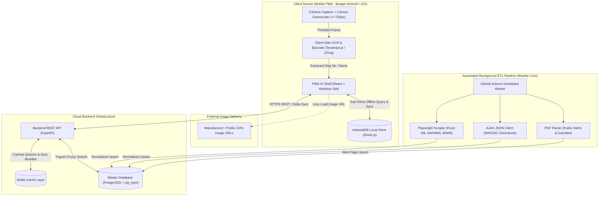

# Product Requirements Document (PRD): CheckAm

* **Version:** 1.0 (V1 MVP Specification)
* **Last Updated:** November 20, 2026
* **Product Name:** CheckAm
* **Platform:** Mobile-First Progressive Web App (PWA)

---

## 1. Introduction

### 1.1 Purpose
**CheckAm** is an offline-first, mobile-optimized Progressive Web App (PWA) designed to empower Nigerian consumers to verify the regulatory status and packaging authenticity of consumable goods—specifically packaged foods, beverages, toothpaste, cosmetics, and essential over-the-counter items—at the point of purchase. By aggregating fragmented regulatory records from NAFDAC portals into a lightning-fast local and cloud search index, CheckAm eliminates the friction of slow government portals, poor market connectivity, and unverified crowdsourced rumors.

### 1.2 Phased Scope
* **V1 MVP (Current Scope):**
  * Automated background ETL ingestion from multiple NAFDAC regulatory portals (Food Products Database, NAPAMS, Greenbook, and Public Safety Alerts).
  * Mobile-first PWA home feed displaying categorized consumer items and high-priority NAFDAC recall/safety alert banners.
  * Instant fuzzy/trigram search by product name, brand, or NAFDAC registration number (`< 100ms` local/cached lookup).
  * Client-side camera capture with HTML5 Canvas resolution downscaling (`<= 720px`) for on-device OCR and barcode extraction.
  * Product Detail view featuring dynamic external manufacturer image URLs, objective NAFDAC registration badges, and a visual packaging authenticity checklist.
  * Offline-first resilience via Workbox Service Workers and IndexedDB (`Dexie.js`) for low-connectivity open-air markets.
  * Native Web Share API integration to share safety alerts via WhatsApp and social channels.
  * *Explicit Exclusions:* No user authentication/accounts, no server-side image blob storage, and no crowdsourced "fake product" reporting (to prevent defamation/trade libel liability).
* **V2 (Post-MVP Expansion):**
  * Multi-language localization (Nigerian Pidgin, Yoruba, Igbo, and Hausa) for broader demographic accessibility.
  * Automated GS1 Nigeria barcode prefix cross-referencing and batch expiry date format validators.
  * Deep-link integration for NAFDAC Mobile Authentication Service (MAS) SMS scratch-code verification.
* **V3 (Ecosystem & Brand Partnerships):**
  * Verified FMCG Manufacturer Portal allowing brand owners (e.g., Unilever, Nestlé, FrieslandCampina) to publish official packaging updates and hologram guides directly.
  * Lightweight USSD fallback gateway for feature-phone users.

---

## 2. Product Concept

### 2.1 Overview & Data Ingestion Sources
Because NAFDAC does not expose a unified public developer API, CheckAm operates a scheduled background ETL pipeline that extracts, cleans, and normalizes public regulatory records from five distinct sources:
1. **NAFDAC Food Products Database (`nafdac.gov.ng/food-products-database/`):** Primary source for registered processed foods, packaged water, dairy, seasonings, and beverages.
2. **NAPAMS Portal (`registration.nafdac.gov.ng`):** NAFDAC Automated Product Administration and Monitoring System, providing registration statuses and renewal records for food, cosmetics, and household consumables (e.g., toothpaste).
3. **NAFDAC iRIMS Portal (`services.nafdac.gov.ng`):** Integrated Regulatory Information Management System used to cross-verify certificate validity and registration prefixes (`01-`, `02-`, `08-`).
4. **NAFDAC Public Safety Alerts & Gazette PDFs (`nafdac.gov.ng/category/public-alerts/`):** Official recall bulletins, banned product notices, and MSME gazette PDFs parsed via `pdfplumber` to highlight dangerous or falsified batches.
5. **NAFDAC Greenbook (`greenbook.nafdac.gov.ng`):** Queried via its underlying server-side jQuery DataTables AJAX JSON endpoint (`X-Requested-With: XMLHttpRequest`) for over-the-counter medicines and herbal supplements.

### 2.2 Target Personas
* **Persona A: The Open-Air Market Shopper (e.g., Chidinma, 34, Lagos)**
  * *Context:* Shops weekly at Mile 12 or Balogun Market using a budget Android smartphone (2GB RAM) on an intermittent 3G/4G data plan.
  * *Goal:* Needs to quickly check if a tin of infant formula, vegetable oil, or tube of toothpaste has a valid NAFDAC number and genuine packaging features before paying, even when mobile data drops inside dense market stalls.
* **Persona B: The Neighborhood Pharmacy / Supermarket Buyer (e.g., Tunde, 28, Abuja)**
  * *Context:* Purchases household staples and toiletries for his family and shares consumer warnings on family WhatsApp groups.
  * *Goal:* Wants to scan product labels quickly via camera OCR, compare physical packaging against an authenticity checklist, and share official recall alerts with relatives.

### 2.3 User Workflows
1. **Browse & Alert Discovery Flow:** User opens CheckAm PWA -> Service Worker loads cached UI shell in `< 1.5s` -> Top sticky carousel displays latest NAFDAC Public Safety Alerts -> User scrolls categorized list of consumable items.
2. **Camera OCR / Barcode Scan Flow:** User taps "Scan Label" -> Browser requests Camera API -> User snaps photo of NAFDAC number or barcode -> Client-side Canvas downscales image to `720px` width -> `Tesseract.js` / `zxing-wasm` extracts text string -> String auto-populates search bar and triggers instant lookup.
3. **Verification & Share Flow:** User selects a matching product -> Views objective status badge (`Official NAFDAC Match`, `Registration Expired`, or `Active Safety Alert`), dynamic manufacturer product image, and visual packaging checklist -> Taps "Share Alert" to send summary via WhatsApp.

### 2.4 High-Level System Architecture

---

## 3. Functional Requirements

| ID | Version | Feature | Description | Acceptance Criteria |
| :--- | :--- | :--- | :--- | :--- |
| **FR001** | V1 | **Home Feed & Safety Alert Banner** | Display a categorized, virtualized list of consumable products alongside a prominent top banner highlighting recent NAFDAC Public Safety Alerts and recalls. | 1. Initial render displays top 20 items and active safety alerts. 2. Category filter tabs (`All`, `Food & Dairy`, `Beverages`, `Toothpaste & Cosmetics`, `OTC`) filter the list in `< 100ms`. 3. Virtualized scrolling maintains 60fps on a 2GB RAM Android device. |
| **FR002** | V1 | **Instant Fuzzy & Reg-No Search** | Allow users to search products by brand name, generic product name, or NAFDAC registration number, resolving queries against local IndexedDB first and falling back to the backend API. | 1. Querying an exact NAFDAC number (e.g., `01-1234` or `011234` with stripped hyphens) returns the matching record in `< 100ms`. 2. Misspelled queries (e.g., `"Cerelack"` instead of `"Cerelac"`) return top relevant matches via trigram/fuzzy matching. 3. If offline, search executes seamlessly against IndexedDB without network errors. |
| **FR003** | V1 | **Client-Side Throttled OCR & Barcode Scan** | Enable users to scan a product barcode or snap a photo of the NAFDAC registration number on packaging using their mobile camera, processing everything locally on the device. | 1. Captured camera frames are resized via HTML5 Canvas to `max-width: 720px` before OCR execution. 2. Extracted NAFDAC numbers or EAN/UPC barcodes automatically populate the search input within `2.5 seconds`. 3. Zero image files are uploaded to or stored on CheckAm's backend servers. |
| **FR004** | V1 | **Product Detail & Regulatory Status View** | Display comprehensive product information including dynamic external product image, manufacturer name, NAFDAC registration number, expiry/status badge, and regulatory disclaimer. | 1. Product image loads lazily from external URL with a clean SVG category fallback if offline or broken. 2. Displays one of three objective badges: `Official NAFDAC Match`, `Registration Lapsed/Unverified`, or `NAFDAC Safety Alert`. 3. Displays mandatory disclaimer noting data is indexed from public NAFDAC registries. |
| **FR005** | V1 | **Visual Packaging Authenticity Checklist** | Provide an interactive checklist on the product detail screen guiding consumers on physical inspection points (e.g., batch date delimiter format, print sharpness, tamper seal, NAFDAC prefix format). | 1. Checklist renders category-specific inspection criteria (e.g., hyphen vs. slash date formatting, foil seal integrity). 2. Users can tap checkboxes interactively at the point of purchase to verify physical attributes. |
| **FR006** | V1 | **Native Web Share Integration** | Allow users to share product verification summaries or official NAFDAC recall alerts directly to messaging apps (WhatsApp, SMS, Telegram). | 1. Tapping "Share" invokes `navigator.share()` on supported mobile browsers with a formatted text summary and deep link. 2. Fallback copies formatted alert text to clipboard with a toast confirmation on unsupported browsers. |
| **FR007** | V1 | **Multi-Source Automated ETL Sync** | Periodically scrape, parse, and normalize product records and safety alerts from NAFDAC Food DB, NAPAMS, Greenbook, and Alert PDFs into PostgreSQL. | 1. Weekly Cron job runs without manual intervention and upserts records idempotently using `nafdac_reg_num` as unique key. 2. Irrelevant industrial/bulk chemical records are filtered out during transformation. 3. Generates a compressed JSON/SQLite delta bundle for PWA offline sync. |

---

## 4. Non-Functional Requirements

| Category | ID | Requirement Specification | Target Metric / Verification Method |
| :--- | :--- | :--- | :--- |
| **Performance** | **NFR001** | Initial PWA load time and local asset caching using Workbox Service Workers and HTTP cache headers (`Cache-Control`, `ETag`). | First Contentful Paint (FCP) `< 1.5s` on simulated 3G; returning visits load shell in `< 500ms`. |
| **Performance** | **NFR002** | Initial JavaScript bundle size budget and image optimization to conserve user mobile data. | Initial gzipped JS bundle `< 150KB`; zero self-hosted image assets; external images lazy-loaded. |
| **Latency** | **NFR003** | Search query execution speed across both client-side IndexedDB and server-side PostgreSQL/Redis. | Local IndexedDB search `< 50ms`; Backend API `/search` response time `< 300ms` (p95). |
| **Availability** | **NFR004** | High cloud availability combined with full offline-first resilience for open-air market environments. | `99.9%` backend uptime; `100%` core search and checklist functionality available when device is completely offline. |
| **Technical Constraints** | **NFR005** | Hardware compatibility with low-end Android smartphones (Android Go, 2GB RAM) common in Nigeria. | Peak browser memory usage during camera OCR capture must stay `< 150MB` without tab crashes. |
| **Security & Privacy** | **NFR006** | Transport security and zero-PII architecture. | Strict HTTPS (TLS 1.3); zero user accounts, zero location tracking, and zero server-side camera photo retention. |

---

## 5. Constraints, Dependencies & Legal Safeguards

### 5.1 Technical Constraints & Dependencies
* **No Official NAFDAC Public API:** CheckAm depends on automated scraping and PDF parsing of `nafdac.gov.ng`, `registration.nafdac.gov.ng`, and `greenbook.nafdac.gov.ng`. HTML DOM changes or WAF/Cloudflare rate-limiting on government servers can temporarily halt ETL updates; therefore, the ETL pipeline must include retry backoff, HTML structure assertions, and webhook failure alerts.
* **External Image Link Rot:** Because CheckAm references external manufacturer/CDN image URLs rather than hosting binaries, third-party URLs may occasionally break or fail to load offline. The frontend must enforce strict `onError` handlers that gracefully swap broken images with lightweight local vector illustrations.
* **OCR Accuracy on Curved Packaging:** Low indoor market lighting and curved surfaces (toothpaste tubes, sachets) can reduce OCR confidence. OCR is strictly constrained to pre-filling the search bar for user confirmation rather than auto-issuing pass/fail verdicts.

### 5.2 Legal & Regulatory Safeguards
* **Mitigation of Defamation & Trade Libel Liability:** Under Nigerian law, falsely labeling a commercial product or vendor's inventory as "Fake" exposes the platform to severe litigation. CheckAm **must never** use the label "Fake" or "Counterfeit" as a system-generated verdict. Instead, UI badges must strictly state objective registry facts:
  * `Official NAFDAC Registry Match` (Verified active record in NAFDAC database)
  * `Not Found in Indexed Registry` (Prompting user to double-check spelling or consult physical packaging checklist)
  * `Official NAFDAC Public Alert` (Directly citing and linking to an official NAFDAC recall bulletin)
* **Removal of Crowdsourced Reporting:** User-submitted "fake product" reports are intentionally excluded from V1 to prevent malicious competitors from weaponizing the platform against legitimate brands and to avoid regulatory overreach.
* **Mandatory Regulatory Disclaimer:** Every product screen must display a clear notice: *"CheckAm is an independent consumer utility that indexes publicly available NAFDAC records. Always inspect physical packaging seals and verify critical medications via NAFDAC's official Mobile Authentication Service (MAS)."*